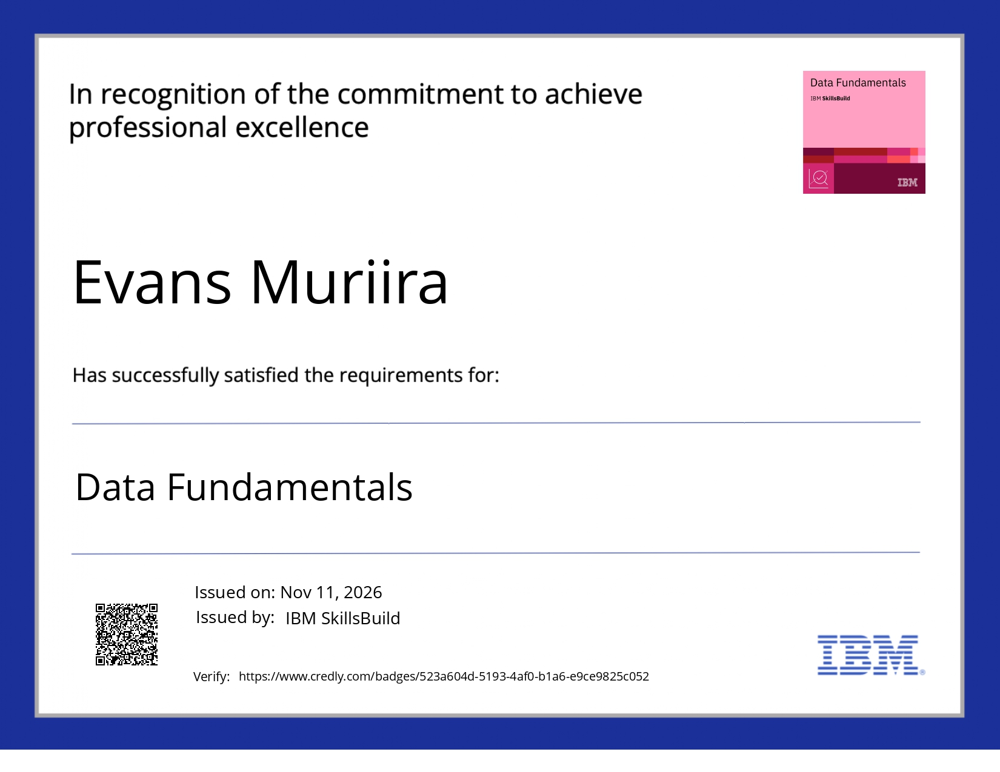

## 👨‍💻 About Me

Hey! I'm **Evans Kithaka (Evans14)**, an Information Technology student at Karatina University with a passion for understanding how technology works beneath the surface.

I'm fascinated by the systems, networks and infrastructure that keep our digital world connected. I enjoy exploring new technologies, solving technical problems and turning theoretical knowledge into practical solutions.

### 🚀 What I'm Exploring
- 🌐 **Networking & Infrastructure** — Network architecture, troubleshooting, routing and switching.
- ☁️ **Cloud Computing** — Understanding cloud infrastructure and distributed systems.
- 🐧 **Linux & Systems Administration** — Exploring Linux environments, command-line tools and system operations.
- 📊 **Data Analytics & Machine Learning** — Using data to uncover patterns and build intelligent solutions.
- 🐍 **Programming & Automation** — Python, SQL and scripting to solve real-world problems.

### 🎯 My Philosophy

> Learn the fundamentals. Understand the systems. Build things that work.

I'm a firm believer that technical competence comes from curiosity, consistent practice and the willingness to break things, understand why they broke, and build them better.

**Currently learning, experimenting and building my way towards becoming a Network Engineer.**

*Always curious. Always building. Always evolving.* ⚡
## 🏆 Digital Credentials

### 📊 Data & Analytics

### 🐧 Linux & Systems

