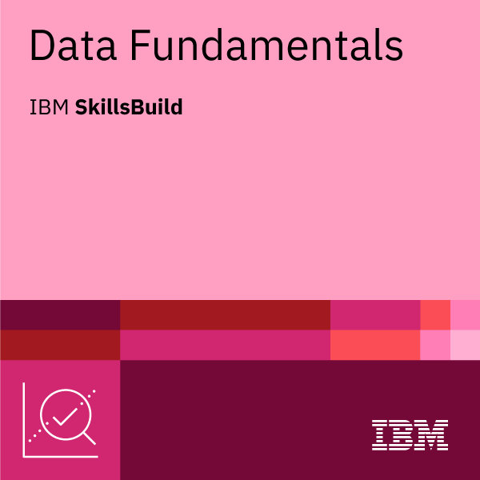

## Hi there 👋

<!--
**Evans-14/Evans-14** is a ✨ _special_ ✨ repository because its `README.md` (this file) appears on your GitHub profile.

Here are some ideas to get you started:

- 🔭 I’m currently working on ...
- 🌱 I’m currently learning ...
- 👯 I’m looking to collaborate on ...
- 🤔 I’m looking for help with ...
- 💬 Ask me about ...
- 📫 How to reach me: ...
- 😄 Pronouns: ...
- ⚡ Fun fact: ...
-->
## 🏆 Certifications

### 🐧 Learn Linux — Boot.dev

## 🏆 Digital Credentials

I am continuously investing in my technical and professional development.

**Data Fundamentals** — [Verify Credential](https://www.credly.com/badges/523a604d-5193-4af0-b1a6-e9ce9825c052/public_url)
